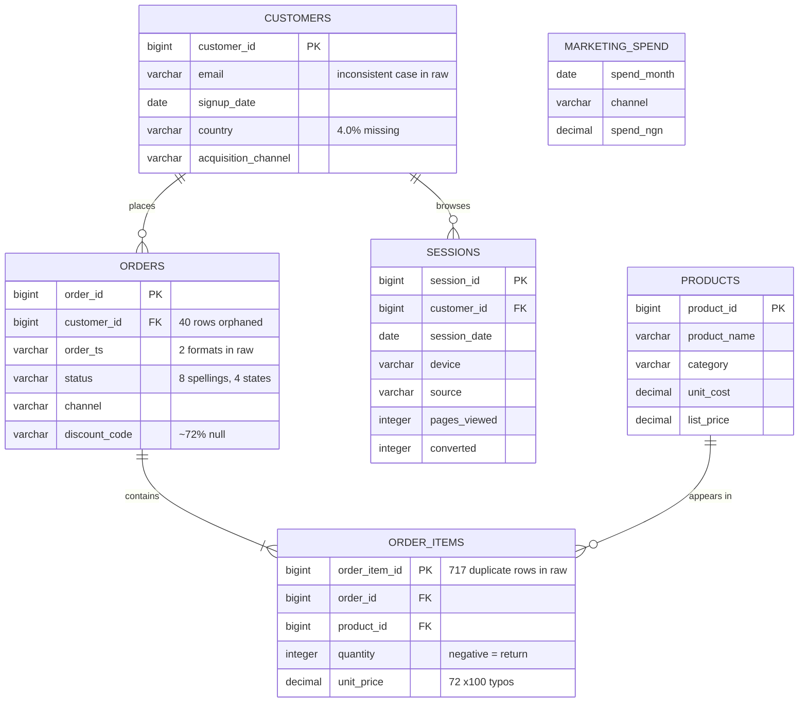

# Schema

GitHub renders the diagram below. The grain statements under it matter more than
the picture: almost every wrong number in analytics comes from joining two
tables at different grains and not noticing the fan-out.



## Grain

| Table | One row per | Rows |
|---|---|---|
| `customers` | customer | 12,000 |
| `products` | product SKU | 72 |
| `orders` | order | 31,127 |
| `order_items` | line item within an order | 60,585 |
| `sessions` | browsing session | 104,449 |
| `marketing_spend` | channel × month | 96 |

`marketing_spend` has **no customer key**. It can only be joined on
`(channel, month)`, which is the reason the CAC figures in Q8 are blended rather
than causal. This is not a modelling oversight; it is what the data permits, and
saying so is the difference between an analyst and a dashboard.

## Model layers

```
raw_*            all VARCHAR, exactly as the CSV arrived
  └─ stg_*       cast, trimmed, de-duplicated, with quality flags
       ├─ fct_orders        one row per order, revenue rolled up from items
       ├─ analysis_orders   fct_orders filtered to recognised, non-test, non-orphan
       └─ dim_customers     one row per customer, lifetime aggregates
            └─ q1..q10      the analysis views
```

Filtering happens in exactly one place. `analysis_orders` is the only view the
analysis queries read, so no individual query can forget to exclude test
accounts and then quietly disagree with its neighbour. When two dashboards show
different revenue for the same month, this is almost always why.

## Join hazards in this schema

- **`orders` → `order_items` fans out.** Joining them and then summing an order
  level column multiplies it by the line count. `fct_orders` pre-aggregates
  items to order grain so downstream queries join at 1:1.
- **`customers` → `orders` is 1:many and 40 orders have no parent.** A plain
  `INNER JOIN` silently drops ₦300,000 of real revenue. `fct_orders` uses a
  `LEFT JOIN` and flags `is_orphan_order` instead.
- **`sessions` and `orders` share no key.** There is no session id on an order,
  so the funnel in Q9 is a same-day heuristic, not a tracked journey. Any
  statement of the form "this session caused this order" is unsupported.
