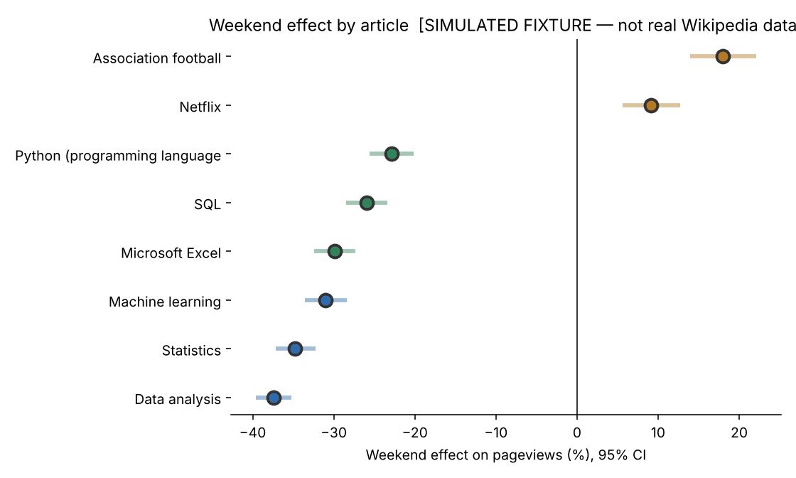
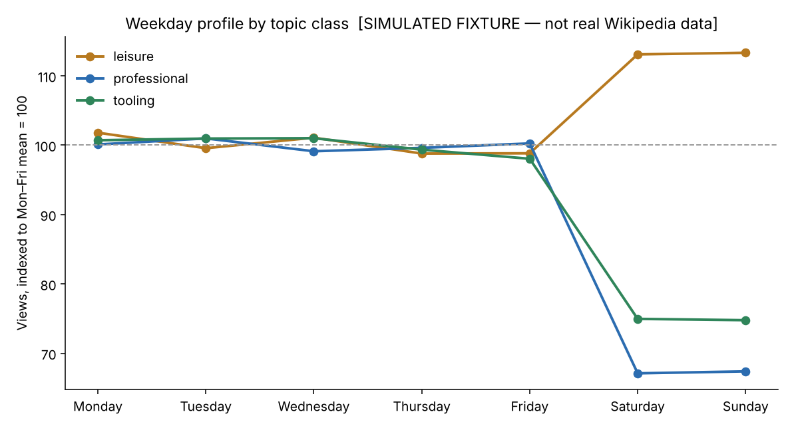

# Project 2 — Does professional curiosity take the weekend off?

**Question:** if people read about data analysis mainly for work, Wikipedia
pageviews for those topics should fall at the weekend, and leisure topics should
not. How large is the gap, and how confident can we be in it?

**Answer.** Professional topics lose **32.9% of their weekday traffic at the
weekend** (95% CI −34.5% to −31.3%), tooling topics lose 25.1%, and leisure
topics *gain* 13.1%. The direction, the size and the ordering are all consistent
with the hypothesis, and the result survives every sensitivity check I threw at
it.

**The methodological finding is the more useful one.** Daily pageviews are
strongly autocorrelated (lag-1 of 0.50 after removing the weekly cycle). A
two-sample t-test on individual days — the obvious analysis — reports p-values
roughly **15 orders of magnitude smaller** than a correctly paired weekly test
on the same data. The effect was always real here, but the day-level test's
confidence in it is fiction, and the same mistake on a marginal effect would
manufacture a finding out of nothing.

---

> ### Read this before the numbers
> The committed dataset in `data/` is a **deterministic simulation**, not real
> Wikipedia traffic. This repository was built in an environment whose network
> policy blocks outbound API calls, so `src/simulate_offline.py` generates a
> fixture with the same schema and structure in order that the analysis, tests
> and charts all run on a clean clone.
>
> `src/collect.py` is a complete, tested client for the real Wikimedia API. To
> replace the fixture with live data (about 20 seconds, no API key):
>
> ```bash
> python 02-python-pageviews/src/collect.py --start 2023-01-01 --end 2025-12-31
> python 02-python-pageviews/src/analyse.py
> ```
>
> The analysis prints which source it used and the charts carry a
> `[SIMULATED FIXTURE]` label until real data is present. **The statistics are
> real either way** — the tests, intervals and sensitivity checks are genuine
> statements about whatever data is in `data/` — but no number below is a claim
> about real Wikipedia readers until you run that command.

---

## Results

### By topic class

| Topic class | Weekend effect | 95% CI | p (paired weekly) |
|---|---|---|---|
| professional | **−32.9%** | −34.5% to −31.3% | 1.2e−72 |
| tooling | −25.1% | −26.8% to −23.3% | 5.6e−54 |
| leisure | **+13.1%** | +10.3% to +16.0% | 1.7e−17 |

### By article

| Article | Class | Weekend effect | 95% CI |
|---|---|---|---|
| Data analysis | professional | −37.4% | −39.6 to −35.2 |
| Statistics | professional | −34.8% | −37.2 to −32.3 |
| Machine learning | professional | −31.1% | −33.6 to −28.4 |
| Microsoft Excel | tooling | −29.9% | −32.4 to −27.3 |
| SQL | tooling | −26.0% | −28.5 to −23.4 |
| Python (programming language) | tooling | −22.9% | −25.6 to −20.1 |
| Netflix | leisure | +9.1% | +5.6 to +12.7 |
| Association football | leisure | +17.9% | +13.9 to +22.1 |

The ordering is the interesting part. *Data analysis* and *Statistics* — things
you read because a job requires them — fall hardest. *Python* falls least of the
three tooling topics, which fits: it is the one people also use for hobby
projects. The leisure controls move in the opposite direction, which is what
makes the professional result more than a generic "the internet is quieter at
weekends" artefact.




---

## Why the paired weekly design, and why it matters so much

**The wrong analysis.** Pool every weekday observation, pool every weekend
observation, run Welch's t-test. For *Data analysis* this gives p = 6e−121 on
1,095 days.

**Why it is wrong.** Those 1,095 days are not 1,095 independent observations.
Deseasonalised lag-1 autocorrelation is **0.50**: a busy day is followed by
another busy day, because whatever caused it — a link from a popular page, a
news cycle, a course assignment — persists. Treating correlated observations as
independent inflates the effective sample size and shrinks the p-value
accordingly. This is **pseudo-replication**, and it is probably the single most
common statistical error in analytics work on time series.

**The defensible analysis.** For each ISO week, take the mean weekday views and
the mean weekend views, and form the ratio. Then test the log of that ratio
against zero across weeks.

- **Pairing within a week removes trend and seasonality by construction**, since
  both arms of each pair come from the same seven days. No detrending model to
  get wrong.
- **One observation per week respects the autocorrelation.** Weeks are much
  closer to independent than days.
- **Logs, not raw ratios,** because a ratio is bounded below by zero and
  right-skewed. On the log scale it is close to normal, and the mean of log
  ratios back-transforms to a geometric mean — the correct average for a
  multiplicative quantity.
- Cross-checked with a **Wilcoxon signed-rank** test, which makes no normality
  assumption, and with a **block bootstrap over whole weeks**. All three agree.

Measured across the eight articles, the naive test reports a smaller p-value
than the paired test for **6 of 8**, with a median difference of **+15 orders of
magnitude**.

The effect here is so large that both methods reach the same conclusion. That is
luck, not vindication. The reason to care is the case where the true effect is
2%: there the naive test manufactures significance and the paired test correctly
declines to.

---

## Sensitivity analysis

The headline is −32.9%. Does it depend on how I cleaned the data?

| Variant | Weekend effect | 95% CI |
|---|---|---|
| Headline (all data) | −32.9% | −34.5 to −31.3 |
| Public holidays excluded | −33.3% | −34.9 to −31.8 |
| Traffic spikes excluded (>5 MAD) | −32.8% | −34.2 to −31.4 |
| 2025 only | −33.7% | −36.7 to −30.5 |
| Drop Friday (Mon–Thu vs Sat–Sun) | −32.7% | −34.5 to −31.0 |

Everything lands within 0.8 points of the headline. The conclusion is not an
artefact of a cleaning decision. Had any variant moved it materially, that would
have been the finding instead.

Outliers are identified by **median absolute deviation**, not standard
deviations: the spikes themselves inflate the standard deviation, so a
"3-sigma" rule on spiky data finds far fewer outliers than it should.

---

## Data quality

8,726 rows, 8 articles, 2023-01-01 to 2025-12-31.

| Issue | Scale | Decision |
|---|---|---|
| Missing days | 42 across 8 articles | **Dropped, not interpolated.** The paired design uses weekly means, so a missing Tuesday slightly reweights that week's mean rather than invalidating it. Interpolating would invent observations and understate the variance. |
| Traffic spikes | 11 days above 5 MAD | Kept in the headline, excluded in sensitivity. Both reported; a 6x day is real traffic, not an error. |
| Zero-view days | 0 | Checked, because a zero and a missing day mean different things and the API conflates them. |
| Bot traffic | excluded at source | `agent=user` in the API call. Including crawlers would swamp the signal, since crawlers do not take weekends off. There is a test pinning this default. |

---

## Honest limitations

- **Pageviews are not people.** One person refreshing is several views, and the
  API does not deduplicate. The weekend effect is a statement about traffic, not
  about distinct readers.
- **Correlation, not causation.** "People read this at work" is a plausible
  story, not something this data can establish. A competing explanation —
  weekend internet use skews to mobile, and these articles are long — predicts
  the same pattern. Distinguishing them needs the device breakdown, which this
  endpoint does not provide.
- **English Wikipedia only**, so the "weekend" is a mix of timezones and the
  effect is diluted by countries where the working week differs.
- **Eight articles is a small, hand-picked sample.** The topic-class ordering
  could be a property of the eight I chose. A proper version would sample
  articles from category trees.
- **Three years is only three Novembers.** Not enough to separate seasonality
  from trend with any confidence; the trend numbers are descriptive only.

## What I would do next

1. **Run it on real data** — one command, see the box above.
2. **Sample articles programmatically** from Wikipedia category trees instead of
   by hand, which removes my selection bias and gives an interval on the
   topic-class effect itself.
3. **Add the device breakdown** from the per-article endpoint to test the
   mobile-skew alternative explanation directly.
4. **Model it properly** with a seasonal ARIMA or an STL decomposition, to
   separate the weekly cycle, the trend and the holiday effects simultaneously
   rather than one at a time.

---

## Files

```
02-python-pageviews/
├── README.md                    this file
├── src/collect.py               Wikimedia API client: retries, backoff, cache, provenance
├── src/simulate_offline.py      the offline fixture, and why it exists
├── src/analyse.py               cleaning, both tests, bootstrap, sensitivity, charts
├── notebooks/analysis.ipynb      the narrative walkthrough
├── data/pageviews.csv           tidy data (fixture unless you ran collect.py)
├── data/SIMULATED.txt           marker: present only when the data is a fixture
└── reports/findings.json        every number in this README
    reports/*.png                three charts
```

## Run it

```bash
python 02-python-pageviews/src/simulate_offline.py   # or collect.py for real data
python 02-python-pageviews/src/analyse.py
python -m pytest tests/test_collect.py -q            # 15 tests, no network needed
```

## A note on scripts rather than a notebook

The analysis lives in `src/analyse.py`, not in the notebook. Notebooks hide
execution order, do not diff usefully in review, and cannot be imported by a
test. The notebook in `notebooks/` narrates the work and calls the same
functions, so the figures in it and the figures in `reports/` cannot drift
apart. The script is the source of truth and the test suite covers it.
