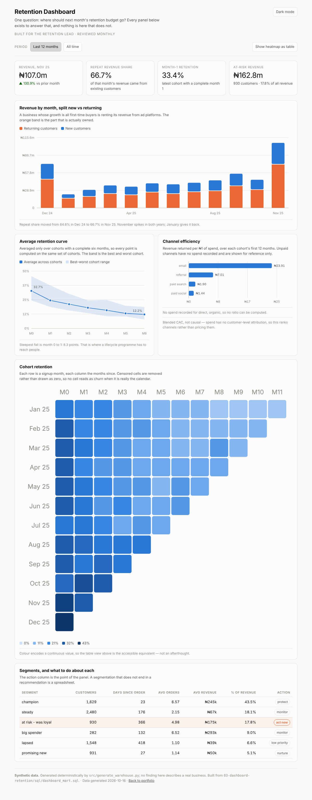

# Project 3 — Retention dashboard

**[→ Open the live dashboard](https://phrheke.github.io/data-analyst-portfolio/dashboard/)**

**Question:** the retention lead has a monthly budget and four minutes. Where
should the money go?

Built for one named reader and one named decision. The
[specification](spec/SPEC.md) was written first and includes a list of things
deliberately **left out** — which is the part of dashboard work that actually
matters.



---

## What it shows

| Panel | The question it answers |
|---|---|
| Four stat tiles | Are we in trouble? Revenue, repeat share, month-1 retention, and the revenue sitting in the at-risk segment. |
| Revenue, new vs returning | Is the growth real, or are we buying it? Repeat share ran 60–70% through 2025. |
| Average retention curve | When do we lose people? The steepest fall is month 0 → 1. |
| Channel efficiency | Which acquisition channel deserves more? Email returns ₦23.91 per ₦1; paid social ₦1.44. |
| Cohort heatmap | Is any cohort behaving differently? With a table view, because colour alone is not an encoding. |
| Segment table | Who exactly do I spend on? With a recommended action per row. |

## The decisions behind it

**One stakeholder, one decision.** Product mix, daily revenue, forecasts and a
total-customers counter were all considered and cut. The test each panel had to
pass: *can the reader change what they do next month because of this?* The spec
lists each omission and why.

**The partial month is excluded in SQL.** The current month is always incomplete
and always looks like a collapse. It is filtered out in
`sql/dashboard_mart.sql`, not in the chart code, so no panel can accidentally
include it.

**Censored cohort cells are drawn as nothing, not zero.** A cohort that has not
had six months yet gets no month-6 cell. Zero would read as total churn — the
single most common way a cohort triangle misleads.

**Every average is over a fixed set.** The retention curve uses only cohorts
with a complete six months, so every point comes from the same cohorts.

**Colour follows the entity, never its rank.** Changing the period filter
repaints nothing. A palette that re-sorts when the data changes teaches readers
to distrust it.

**No logic in the BI layer.** A calculated field inside a workbook is invisible
to review, impossible to test, and lost on the next rebuild. Everything is in
`sql/dashboard_mart.sql`.

## Why a hand-built dashboard rather than a Tableau screenshot

Because a screenshot cannot be interrogated. This one is live: hover any mark
for the underlying numbers, switch themes, change the period, and flip the
heatmap to a table.

It also forced the accessibility work that a BI tool would have hidden. The
categorical palette is validated against a colour-vision-deficiency simulator
rather than eyeballed (worst adjacent pair ΔE 9.2 light / 9.4 dark, target ≥ 8).
Dark mode is a selected set of steps checked against the dark surface — the
sequential ramp is **reversed** in dark mode, because the near-zero end has to
recede toward the surface in both themes, which an automatic inversion gets
backwards.

The mart is tool-agnostic. `spec/SPEC.md` is a build brief anyone could follow
in Power BI or Looker Studio, and `data.json` has the shape a scheduled BI
extract would have.

## Honest limitations

- **It is a static extract, not a live connection.** GitHub Pages serves files
  only. `make dashboard` regenerates the data; a real deployment would schedule
  that.
- **No row-level security, no user state.** Everyone sees the same thing.
- **Six panels is near the limit.** A seventh would start to compete for
  attention rather than add to the decision.
- **Synthetic data**, generated by `src/generate_warehouse.py`.
- **Not load-tested on a large extract.** At 40 KB and ~250 marks it renders
  instantly; a million-row extract would need the aggregation pushed further
  into SQL or a real BI engine.

## Files

```
03-dashboard-retention/
├── README.md                     this file
├── spec/SPEC.md                  the brief, written before the build
├── sql/dashboard_mart.sql        six purpose-built views
├── src/export_dashboard_data.py  warehouse -> data.json + data.js
└── screenshots/                  light and dark, and a phone-width view

docs/dashboard/
├── index.html                    the dashboard itself, no dependencies
└── data.js / data.json           the extract
```

## Run it

```bash
make data warehouse          # from the repository root
make dashboard               # regenerate docs/dashboard/data.js
open docs/dashboard/index.html
```

The page loads its data from a `<script>` tag rather than `fetch`, so it works
when opened directly from disk as well as when served. A `fetch("data.json")` is
blocked by the browser's same-origin policy on `file://` URLs, and a reviewer
who double-clicks the file should not be met with an empty page.
